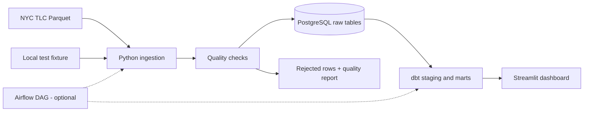

# NYC Taxi Data Platform

Python ingestion and data quality checks for New York City's yellow taxi trip records, followed by SQL/dbt models and a Streamlit dashboard. The pipeline can run against a small local fixture or a monthly Parquet file from the [NYC Taxi & Limousine Commission](https://www.nyc.gov/site/tlc/about/tlc-trip-record-data.page).

## What it does

1. Downloads or opens a yellow taxi Parquet file.
2. Validates required fields, trip times, distances, passenger counts, locations, and monetary values.
3. Preserves suspicious-but-valid trips with quality flags and writes rejected rows to a local report.
4. Loads accepted records into PostgreSQL; database conflicts prevent reinserting the same dataset/record fingerprint.
5. Builds staging, daily, and hourly analytics tables with dbt.
6. Displays trip counts, total amounts, distance trends, and quality flags in Streamlit.



## Stack

Python · pandas · PyArrow · SQLAlchemy · PostgreSQL · dbt · pytest · Docker Compose · Streamlit. An Airflow 3 DAG is provided for environments where Airflow is installed and configured separately.

## Getting started

Python **3.12** and Docker Desktop/Engine are recommended. Commands below assume you are in the repository root.

```bash
python -m venv .venv
# macOS/Linux: source .venv/bin/activate
# Windows PowerShell: .\.venv\Scripts\Activate.ps1
python -m pip install --upgrade pip
python -m pip install -e ".[dev,dbt,dashboard]"
```

Copy `.env.example` to `.env` (`cp .env.example .env` on macOS/Linux, or `Copy-Item .env.example .env` in PowerShell). Default database credentials are intended for **local development only**. Replace them before using a shared environment. Docker Compose reads `.env`, and the Python CLI loads it through `python-dotenv`.

Start PostgreSQL:

```bash
docker compose up -d postgres
```

### First run: small offline fixture

The JSON fixture is checked in, so the demo does not require downloading NYC TLC data. It contains accepted, flagged, rejected, and duplicate examples.

```bash
python scripts/create_fixture_parquet.py
python -m taxi_pipeline.cli --source-path data/raw/sample_yellow_trips.parquet
```

The command creates `data/processed/sample_yellow_trips.parquet.quality.json` and `data/rejected/sample_yellow_trips.parquet.rejected.json` and inserts accepted rows in PostgreSQL. The fixture uses its **own dataset name** to avoid being confused with the monthly TLC source.

Repeat the CLI command to check that a second run doesn't insert duplicates.

### Build SQL models

Copy `dbt/profiles.yml.example` to `dbt/profiles.yml`. The local profile uses the database credentials shown above by default; environment variables can override them.

```bash
cd dbt
dbt debug --profiles-dir .
dbt build --profiles-dir .
cd ..
```

The main models are `stg_yellow_trips`, `fct_yellow_trips`, `dim_date`, `daily_trip_metrics`, and `hourly_pickup_metrics`. The dbt project places the staging models in `analytics_staging` and the mart models in `analytics_marts`.

### Explore the dashboard

```bash
python -m streamlit run dashboard/app.py
```

Alternatively, after the models have been built, use `docker compose up --build dashboard` to run Streamlit in a container. The dashboard runs on <http://localhost:8501>.

### Load the real monthly dataset

With PostgreSQL running, omit `--source-path`:

```bash
python -m taxi_pipeline.cli
```

The CLI defaults to the latest verified 2026 yellow taxi month used by this repo, currently August 2026. The official TLC publication schedule can lag the calendar, so prefer discovery commands when working with live data:

```bash
python -m taxi_pipeline.cli --latest
python -m taxi_pipeline.cli --year 2026 --month 8
python -m taxi_pipeline.cli --year 2026 --all-available
python -m taxi_pipeline.cli --year 2026 --all-available --start-month 1 --end-month 3
```

Downloaded monthly Parquet files are cached under `data/raw/`. Run `dbt build` again afterward. **Use a fresh development database** if you previously loaded the synthetic fixture and need metrics based solely on real trips.

Note: the current implementation reads an entire Parquet file into memory. A full month can require significant RAM; use the fixture for the first run and consider chunked processing before backfilling multiple months.

## Testing

```bash
python -m pytest
ruff check src tests scripts dashboard
```

Unit tests cover validation, duplicate detection, configuration, and local SQLite loading. The SQLite fixture test also checks a complete extract → validate → report → load path without network access. A GitHub Actions workflow runs checks on pushes and pull requests; PostgreSQL, dbt, dashboard, and Airflow services still require their own integration verification.

## Design choices and limitations

- **Rejected vs flagged records:** broken data is excluded from the raw analytics input, while unusual but plausible trips stay available with explicit flags.
- **Rerun handling:** the loader applies a uniqueness constraint on `(dataset_name, trip_hash)` and uses database-supported conflict handling. The fingerprint is a heuristic; distinct trips can look identical in the available source fields.
- **Gross revenue:** charts use the sum of `total_amount`, including any signed adjustments. This is not an accounting-grade net revenue measure.
- **Deployment:** Docker Compose provides PostgreSQL and the dashboard. The Airflow DAG is source code, not a complete Airflow deployment. See [Airflow notes](docs/orchestration.md).
- **Processing scale:** in-memory pandas extraction has not been benchmarked on a full monthly file here. Chunking and operational monitoring are future improvements.

## Project layout

| Location | Purpose |
| --- | --- |
| `src/taxi_pipeline/` | Extraction, validation, loading, CLI |
| `tests/` | Deterministic fixture and regression tests |
| `dbt/` | Source definitions, staging models, marts, SQL tests |
| `dashboard/` | Read-only Streamlit application |
| `dags/` | Optional Airflow 3 DAG |
| `docs/` | Architecture, data dictionary, engineering decisions, troubleshooting |
| `.github/workflows/` | Continuous integration |

See [architecture](docs/architecture.md), [data dictionary](docs/data_dictionary.md), and [engineering decisions](docs/decisions.md) for more detail. Local Parquet files, generated reports, database state, passwords, and virtual environments are excluded from Git.

**Data source:** NYC TLC Trip Record Data. Official HEAD checks confirmed 2026 yellow taxi Parquet files for January through August 2026 and no files for September through December 2026 at the time this project was verified. Recheck the TLC page or run `--latest` before assuming newer months exist.
